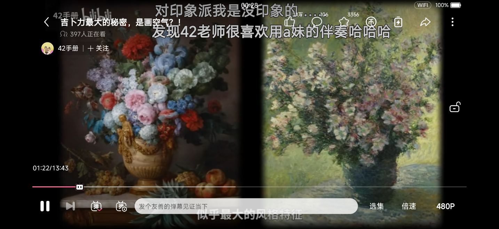
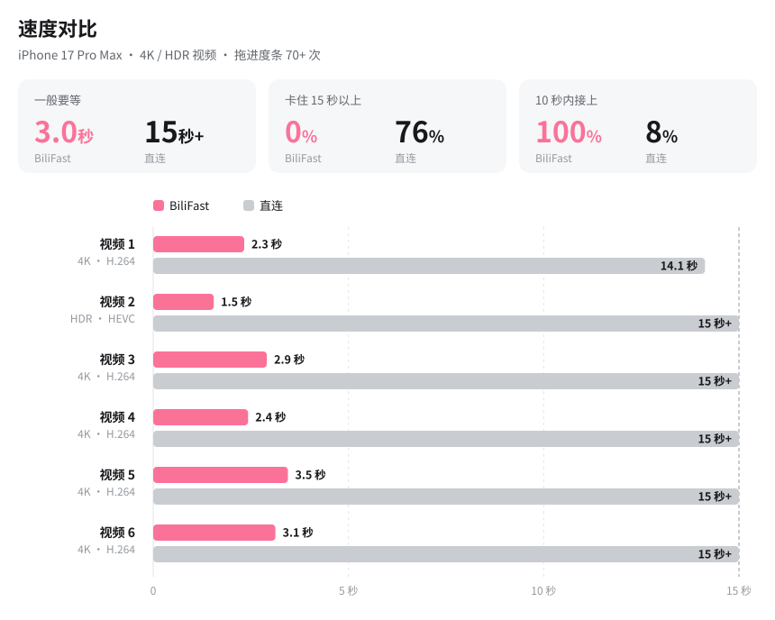

<div align="center">
  
  <h1>BiliFast</h1>
  <p><b>还是熟悉的味道，就是快了亿点点。</b></p>

  [](#-安装)
  [](#-安装)
  [](https://github.com/MrTangLuyao/Bilibili-thread-ripper)
  [](#-安装)

  [**安装**](#-安装) · [功能](#-功能) · [常见问题](#-常见问题) · [播放原理](#-播放原理) · [实测](#-实测) · [Releases](https://github.com/KaiC5504/BiliFast/releases)

  <!-- 截图都是我们自己的 App（Windows 版，未登录），不放官方 App 的截图。 -->
  
  
  <br/>
  
</div>

BiliFast 是一个从零开始写的第三方 B 站客户端，用 Flutter 开发，不是在官方 App 上打补丁。目标就两个：

- **界面和官方一样**：每个页面都对照官方 iPhone App 的截图和录屏做过像素级比对，图标、加载动画、占位图这些素材也直接取自官方 App，用起来没有适应成本。
- **播放更快**：内置 [Bilibili 线程撕裂者](https://github.com/MrTangLuyao/Bilibili-thread-ripper)（BTR）下载引擎的 Dart 移植版，视频分段同时从多个 CDN 节点拉取，播放用系统自带的 AVPlayer。

## 📦 安装

需要 iOS / iPadOS 26 及以上。

> [!NOTE]
> TestFlight 公开测试被苹果拒了 😭 第三方 B 站客户端过不了审，目前只能自签安装 IPA。

到 [Releases](https://github.com/KaiC5504/BiliFast/releases) 下载最新的 IPA，任选一种方式安装：

| 方式 | 需要 | 7 天后 |
| --- | --- | --- |
| **电脑签名** | 电脑 + Sideloadly 或 AltServer | 用电脑重签；AltServer 开着且在同一 Wi-Fi 下会自动续签 |
| **SideStore** | 第一次用电脑装好 SideStore，再从 App Store 装 LocalDevVPN | 打开 LocalDevVPN，在 SideStore 里刷新，手机上就能完成 |
| **已有证书** | 付费开发者账号，或 Feather 等签名工具里已有的证书 | 不用管，到证书过期为止 |

更新：下载新版 IPA，用同一种方式覆盖安装，数据会保留。每个版本的更新内容写在 Releases 里。

SideStore、AltStore Classic 和 Feather 可以添加源 `https://github.com/KaiC5504/BiliFast/releases/latest/download/source.json`，之后新版本直接在里面更新。

> [!NOTE]
> iPad 版还在早期开发阶段，目前只适配了首页、视频页和全屏播放，其他页面暂时是 iPhone 布局拉宽，很多功能还没做完。

## ✨ 功能

### 播放
- [x] BTR 多节点并行下载，支持 4K、8K、真彩 HDR、杜比视界
- [x] 画中画，退出视频页也能继续播
- [x] 后台听视频：锁屏、切到后台继续播，锁屏上有封面、进度条和上一个 / 下一个，支持后台连播
- [x] 和官方一样的横竖屏旋转动画
- [x] 手势调节亮度、音量、进度，双击暂停，长按倍速
- [x] 清晰度、倍速、选集面板，竖屏模式，播放结束页
- [x] 进度条上的小电视会跟着拖动方向看，按住进度条显示预览图
- [x] 记住播放进度，并同步到历史记录
- [x] 播放设置：详情页是否直接播放、直接全屏，流量下是否自动播放，竖屏视频用不用竖屏模式

### 弹幕
- [x] 弹幕设置即改即生效，屏幕上的弹幕立刻跟着变
- [x] 人像防挡：弹幕不挡人（视频本身支持才有）
- [x] 屏蔽词与账号同步
- [x] 当前弹幕列表，可点赞、屏蔽
- [x] 横屏、竖屏、小窗都能发弹幕，支持颜色和位置

### 视频页
- [x] 简介、标签、合集、分 P、相关推荐
- [x] 点赞、投币、收藏、不喜欢
- [x] 评论区：富文本、表情、图片、@、草稿
- [x] 点 UP 主头像弹出卡片，不打断播放

### 首页、动态、搜索
- [x] 官方推荐流，支持个性化推荐和不感兴趣，大卡片自动播放，可以关掉或默认静音
- [x] 下拉刷新，没松手就开始加载
- [x] 动态：全部 / 视频、最常访问、图文、转发，视频自动播放
- [x] 搜索：热搜、搜索历史、联想词、综合筛选、用户

### 我的
- [x] 个人数据、会员卡、常用入口
- [x] 装扮：首页、我的、底栏都会换成你穿戴的装扮，状态栏颜色自动适配
- [x] UP 主空间、个人空间（空间头图、收藏集视频）
- [x] 我的好友：关注、粉丝、搜索、取消关注、特别关注
- [x] 收藏夹、稍后再看（支持批量管理）、历史记录
- [x] 离线缓存：视频保存在本地，原视频下架也能看，弹幕一并保存；切到后台继续下载
- [x] 设置：播放、首页推荐、字体、CDN 节点、图片缓存、开发者日志
- [x] 自签安装：设置里显示签名到期时间，到期前一天提醒，有新版本会提示

### 加载优化
- [x] 图片本地缓存（最多 500 MB），返回页面不用重新加载
- [x] 封面使用和官方 App 相同的 CDN 和尺寸，复用同一个连接

### 计划中
- [ ] 番剧
- [ ] 直播
- [ ] 完善 iPad 版

## ❓ 常见问题

<details>
<summary><b>和 BTR 是什么关系？</b></summary>

BiliFast 的下载引擎是从 BTR 移植过来的，在此基础上又做了提速；除此之外的部分都是我自己写的，和 BTR 原作者没有关系。遇到问题请在本仓库提 Issue。

</details>

<details>
<summary><b>登录安全吗？</b></summary>

登录走的是 B 站官方的登录页面，登录信息只保存在手机的钥匙串里。这个 App 没有自己的服务器，不会把数据发到别的地方。

</details>

<details>
<summary><b>为什么点「授权」会跳到官方 App？</b></summary>

个性化推荐、不感兴趣和「不喜欢」用的是官方 App 的接口，需要在官方 App 里确认授权。点「授权」后会跳转到官方 App，确认完再切回来就行。不授权也不影响使用，推荐会改用网页版的推荐流。

</details>

<details>
<summary><b>能和官方 App 同时安装吗？</b></summary>

可以，两者互不影响。

</details>

## ⚡ 播放原理

```
 B 站 CDN 节点 ──┬──▶  BTR 引擎  ──▶  本地 HLS 服务  ──▶  AVPlayer
  （多个同时）   │    （后台 isolate）    （运行在手机上）   （系统播放器：
                 │                                         画中画、HDR、杜比视界）
                 └──  节点健康检测、失败重试、优先最快节点
```

引擎运行在独立的 isolate 里，所有视频页共用一个。对播放器来说，它拿到的只是一个普通的 HLS 流，所以画中画、HDR、杜比视界都和系统自带 App 表现一致。

## 🚀 实测

<p align="center">
  
</p>

## 🛠️ 开发

代码在 Windows 上编写和测试；一台 Mac mini 通过 SSH 远程编译，装到模拟器和真机上验证；发版由 GitHub Actions 构建，上传 TestFlight 并发布 IPA。

- Flutter 3.47.7，用 [fvm](https://fvm.app) 管理版本：`fvm flutter test`、`fvm flutter analyze`
- `python scripts/gate.py` 一键跑完全部检查：引擎、App、工作流、Swift 语法检查，以及运行真实引擎的 Windows 版
- Windows 版会以 iPhone 尺寸的窗口运行，每次发版前都会在上面把改动过的按钮逐个点一遍
- `python scripts/mac.py sim` 在 Mac 上编译当前提交并截模拟器的图，`phone` 直接装到手机

`lib/` 是 App 本体；`packages/bili_core/` 是纯 Dart 代码，包括 API 客户端、BTR 引擎和本地 HLS 服务、弹幕、日志和业务逻辑。设计上的取舍记录在 `CLAUDE.md` 和 `docs/` 里。

## 🔒 隐私

不收集任何数据，没有服务器、统计、广告或追踪。详见[隐私政策](docs/privacy.md)。

自签安装时：
- 每次启动、以及点「检查更新」时，会向 GitHub 查一次有没有新版本。GitHub 能看到你的 IP 地址，开发者收不到任何信息。
- 通知权限只用来在签名到期前一天提醒你，你同意后才会申请。

## 📄 声明与致谢

本项目是非官方的个人项目，仅供学习交流和个人使用，与哔哩哔哩官方无关。App 使用你自己的账号访问 B 站的公开接口，不会绕过账号本身的权限。哔哩哔哩的名称、素材及内容版权归哔哩哔哩所有。

- [Bilibili 线程撕裂者](https://github.com/MrTangLuyao/Bilibili-thread-ripper)：下载引擎的来源，MIT 许可证，移植的代码中保留了原版权声明
- [PiliPlus](https://github.com/bggRGjQaUbCoE/PiliPlus)：B 站接口行为的参考，部分官方素材也取自这里（见 `assets/README.md`），未使用其代码
- [MiSans](https://hyperos.mi.com/font/zh/)：内置字体，版权归小米所有，按其免费授权使用，不属于本仓库代码的许可范围
- [lottie](https://pub.dev/packages/lottie)、[cupertino_http](https://pub.dev/packages/cupertino_http)、[pigeon](https://pub.dev/packages/pigeon) 以及 `pubspec.yaml` 中的其他依赖
